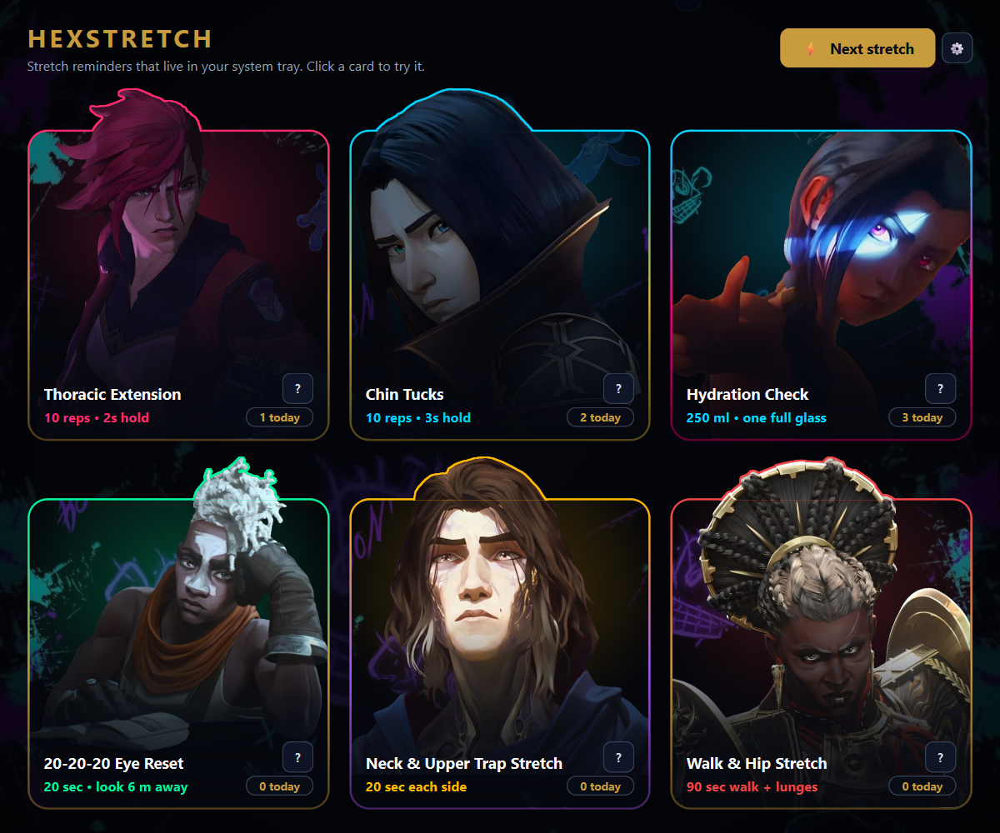
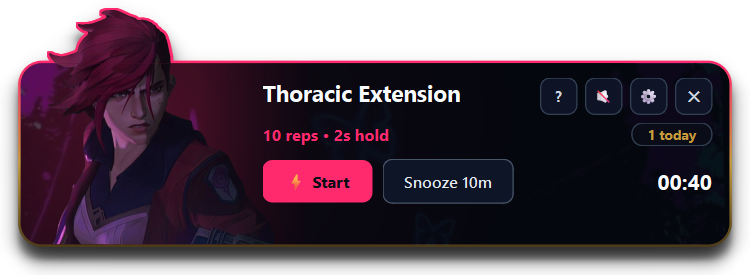

[فارسی](README.md) | **English**

# HexStretch

A small Windows reminder app. Every so often a character from Arcane drops in from the top of the screen and tells you to stretch, or to drink a glass of water.



## Why

If you spend hours at a laptop, your head has probably drifted forward, your shoulders have rounded, and you can't remember the last time you drank water. Everyone knows they should move every half hour. The trouble is remembering to in the middle of work.

HexStretch does the remembering: one short stretch every 20 minutes (under two minutes each) and a glass of water every hour. Being told "Drop the hunch, Cupcake" by Vi also works a lot better than a plain Windows notification.

## Features

- Five desk stretches in rotation, plus a water reminder
- Pop-up at the top of the screen with a timer and a daily counter
- A "?" button with step-by-step instructions for each stretch
- Persian and English UI
- Lives in the system tray; closing the window keeps it running

<p align="center">
  
</p>

## Install and run

Needs Windows 10 or 11 and Python 3.10+.

1. Download the repo (green **Code** button → **Download ZIP**) and unzip it.
2. Install the one dependency:

   ```bash
   pip install -r requirements.txt
   ```

3. Double-click `run_hexstretch.bat`, or:

   ```bash
   python hexstretch.py
   ```

Reminder intervals, sound, language and start-with-Windows are under ⚙. Settings stay on your computer; nothing is sent over the internet.

## Changing the pictures

Replace the files in `assets/` with your own and restart the app. No code changes needed.

| File | Used for |
|---|---|
| `vi.png` | Thoracic extension |
| `caitlyn.png` | Chin tucks |
| `jinx.png` | Hydration |
| `ekko.png` | 20-20-20 eye reset |
| `viktor.png` | Neck & upper trap stretch |
| `ambessa.png` | Walk & hip stretch |
| `background.jpg` | Background |

- Keep the exact file names.
- Character images must be PNGs with a transparent background (remove.bg or Paint's Remove background on Windows 11 will do it).
- Size doesn't matter. Empty margins are trimmed automatically, and if a character's head is cut off at the top of the picture, the app keeps it inside the card frame.

## Health note

These stretches are meant for healthy people who sit a lot. If you have pain or an injury, check with a physiotherapist or doctor first.

## License

The code is released under the [MIT License](LICENSE): free to use and modify, with attribution.

The [Vazirmatn](https://github.com/rastikerdar/vazirmatn) font has its own license ([SIL OFL 1.1](assets/Vazirmatn-OFL.txt)). The character artwork is from Arcane and belongs to Riot Games; this is a non-commercial fan project and the MIT license does not cover the artwork.

> HexStretch isn't endorsed by Riot Games and doesn't reflect the views or opinions of Riot Games or anyone officially involved in producing or managing Riot Games properties. Riot Games, and all associated properties are trademarks or registered trademarks of Riot Games, Inc.
