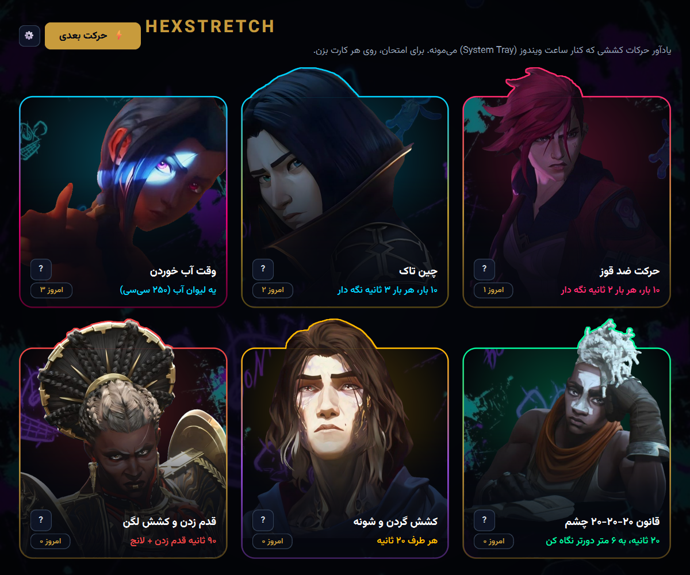
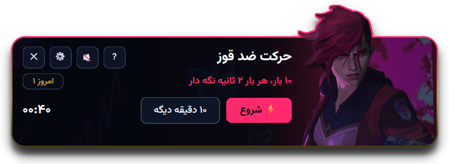
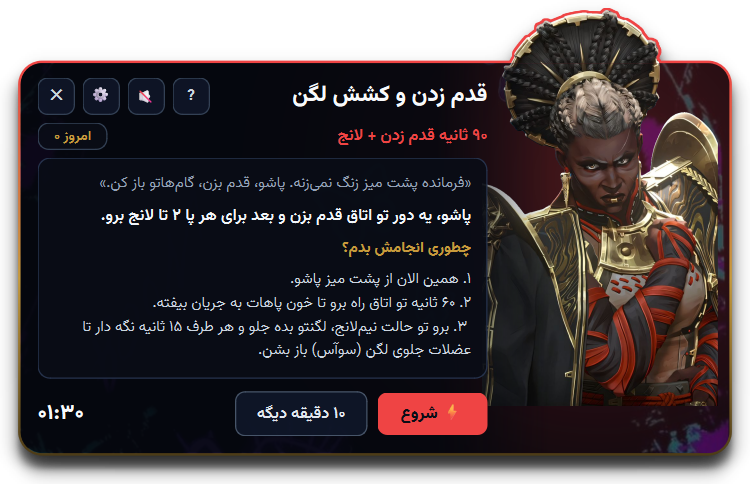

**فارسی** | [English](README.en.md)

# HexStretch

یه یادآور کوچیک برای ویندوز. هر چند دقیقه یه بار یکی از کاراکترهای Arcane از بالای صفحه میاد و می‌گه پاشو یه حرکت کششی برو، یا یه لیوان آب بخور.



## چرا؟

اگه روزی چند ساعت پشت لپ‌تاپ می‌شینی، احتمالاً گردنت اومده جلو، شونه‌هات قوز کرده و یادت نیست از صبح چقدر آب خوردی. همه می‌دونیم باید هر نیم ساعت یه تکونی بخوریم. مشکل اینه که وسط کار یادمون می‌ره.

HexStretch همین یادآوری رو انجام می‌ده: هر ۲۰ دقیقه یه حرکت ساده که کمتر از دو دقیقه طول می‌کشه، هر یه ساعت یه لیوان آب. وقتی Vi بهت می‌گه «قوز نکن کاپ‌کیک!»، خیلی بیشتر از یه نوتیف خشک‌وخالی ویندوز جواب می‌ده.

## چی داره

- ۵ حرکت کششی که به نوبت میان، به‌علاوه‌ی یادآور آب
- پاپ‌آپ بالای صفحه با تایمر و شمارنده‌ی روزانه
- دکمه‌ی «?» برای توضیح قدم‌به‌قدم هر حرکت
- فارسی و انگلیسی
- آیکون کنار ساعت ویندوز. پنجره رو ببندی، برنامه پشت صحنه کارشو می‌کنه

<p align="center">
  
  <br>
  
</p>

## نصب و اجرا

ویندوز ۱۰ یا ۱۱ و پایتون 3.10 به بالا لازمه.

۱. ریپو رو دانلود کن (دکمه‌ی سبز **Code** ← **Download ZIP**) و از حالت فشرده درش بیار.

۲. یه بار پکیج لازم رو نصب کن:

```bash
pip install -r requirements.txt
```

۳. روی `run_hexstretch.bat` دابل‌کلیک کن، یا:

```bash
python hexstretch.py
```

فاصله‌ی یادآورها، صدا، زبان و اجرا با روشن شدن ویندوز از ⚙ تنظیم می‌شن. تنظیمات فقط روی کامپیوتر خودت ذخیره می‌شه و هیچی به اینترنت فرستاده نمی‌شه.

## عوض کردن عکس‌ها

فایل‌های پوشه‌ی `assets` رو با عکس‌های خودت جایگزین کن و برنامه رو یه بار ببند و باز کن. کدی لازم نیست دست بزنی.

| فایل | کجا نشون داده می‌شه |
|---|---|
| `vi.png` | حرکت ضد قوز |
| `caitlyn.png` | چین تاک |
| `jinx.png` | آب خوردن |
| `ekko.png` | قانون ۲۰-۲۰-۲۰ چشم |
| `viktor.png` | کشش گردن و شونه |
| `ambessa.png` | قدم زدن و کشش لگن |
| `background.jpg` | پس‌زمینه |

- اسم فایل باید دقیقاً همین باشه.
- عکس کاراکتر باید PNG با پس‌زمینه‌ی شفاف باشه. پس‌زمینه رو با remove.bg یا Remove background توی Paint ویندوز ۱۱ بردار.
- اندازه مهم نیست. حاشیه‌ی خالی خودکار بریده می‌شه و اگه سر کاراکتر توی عکس بریده باشه، برنامه خودش داخل قاب نگهش می‌داره.

## نکته‌ی سلامتی

این حرکت‌ها برای کسیه که سالمه و فقط زیاد می‌شینه. اگه درد یا آسیب‌دیدگی داری، اول با فیزیوتراپ یا دکترت چک کن.

## لایسنس

کد با لایسنس [MIT](LICENSE) منتشر شده: استفاده و تغییرش آزاده، به شرط ذکر منبع.

فونت [Vazirmatn](https://github.com/rastikerdar/vazirmatn) لایسنس خودش رو داره ([SIL OFL 1.1](assets/Vazirmatn-OFL.txt)). عکس کاراکترها از سریال Arcane و مال Riot Games هستن. این یه فن‌پروژه‌ی غیرتجاریه و لایسنس MIT شامل عکس‌ها نمی‌شه.

> HexStretch isn't endorsed by Riot Games and doesn't reflect the views or opinions of Riot Games or anyone officially involved in producing or managing Riot Games properties. Riot Games, and all associated properties are trademarks or registered trademarks of Riot Games, Inc.
